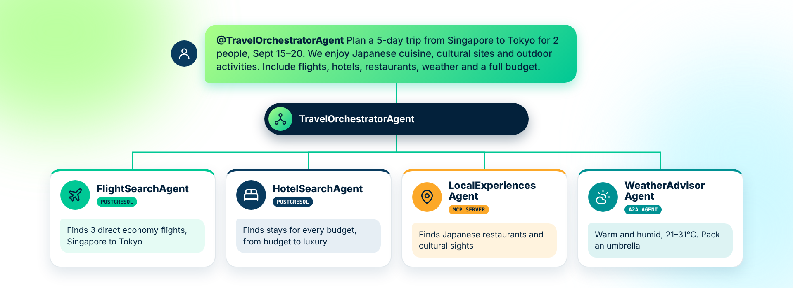

# The Use Case: Multi-Agent Travel Planning

In this workshop you build a **multi-agent travel planning system**. Specialist agents each own one part of planning a trip. An orchestrator agent coordinates them, so that a complete trip plan comes back from a single conversation.

---

## Table of Contents

- [What you are building](#what-you-are-building)
- [Without agents: what you'd have to hand-build](#without-agents-what-youd-have-to-hand-build)
  - [Challenges and limitations](#challenges-and-limitations)
- [Why the travel-planner toolset](#why-the-travel-planner-toolset)
- [The agents](#the-agents)
- [How a request flows through the system](#how-a-request-flows-through-the-system)
- [Where everything runs](#where-everything-runs)
- [How you build it](#how-you-build-it)
- [Sample query](#sample-query)

---

## What you are building

Planning a trip means pulling together information from very different sources: flight schedules and fares, hotel availability and rates, restaurants and attractions, and the weather forecast. No single tool or data source covers all of it, and each source needs different expertise to query well.

The system splits this work the way a travel agency would. Each specialist agent knows one domain and one data source. An orchestrator agent takes the traveler's request, decides which specialists to involve, and combines their answers into one plan, with a day-by-day itinerary and a full budget.

  

Along the way, the system uses every main kind of Agent Mesh building block: connectors to a database and an MCP server, a custom toolset, an external agent connected over A2A, peer delegation between agents, and a workflow.

---

## Why the travel-planner toolset

Deterministic math doesn't belong in a prompt. Compiling a day-by-day itinerary and calculating a trip budget are exact, repeatable operations. That kind of logic belongs in code, not in a language model's guess. 

| Without a custom toolset | With the travel-planner toolset |
|---|---|
| The LLM is asked to add up nightly rates, flight fares, and daily spend by itself | `compile_itinerary` and `calculate_budget` run as compiled Go functions |
| Totals vary between runs: the same trip can price out differently twice | The same inputs always produce the same totals, exactly, every time |
| There is no shared, testable logic: every agent that needs a budget works it out again | One reusable tool, callable by any agent or workflow that needs it |
| Formatting and rounding drift, and errors are easy to miss and hard to audit | The agent focuses on reasoning and delegation, not arithmetic |

You add the toolset in [Using Custom Tools](./07_Handson_custom_tools.md).

---

## The agents

| Agent | How it is built | Role |
|---|---|---|
| **FlightSearchAgent** | PostgreSQL connector | Searches a database of 350+ airports, 300+ airlines, and 14,000+ routes for direct and connecting flights |
| **HotelSearchAgent** | PostgreSQL connector | Searches 700+ hotels worldwide, from city hotels to beachfront resorts, with star ratings, room types, and pricing |
| **LocalExperiencesAgent** | MCP connector | Finds restaurants and attractions using live data from the Foursquare Places API |
| **WeatherAdvisorAgent** | External A2A agent | A LangChain agent that fetches live forecasts from Open-Meteo and recommends what to pack |
| **TravelOrchestratorAgent** | Custom toolset and peer delegation | Routes each request to the right specialists or to TravelPlanningWorkflow, then uses the `compile_itinerary` and `calculate_budget` tools to produce the final plan |

The system also includes **TravelPlanningWorkflow**, a workflow that runs the flight, hotel, and local experience searches in parallel, then compiles the itinerary and calculates the budget in a fixed sequence.

All communication between the agents, the workflow, and the tools runs over the Solace event broker.

---

## Where everything runs

| Component | Runs on |
|---|---|
| Solace Agent Mesh and your agents | Your GitHub Codespace (or SAM Desktop on your machine) |
| Travel database (PostgreSQL) | AWS EC2, pre-deployed for you |
| Places MCP server | AWS EC2, pre-deployed for you |
| Weather Advisor A2A agent | AWS EC2, pre-deployed for you |

You do not need to deploy any backend services. Connection details are provided in the hands-on guides.

---
Section complete! Close this file and return to the Workshop Tracker to continue.
